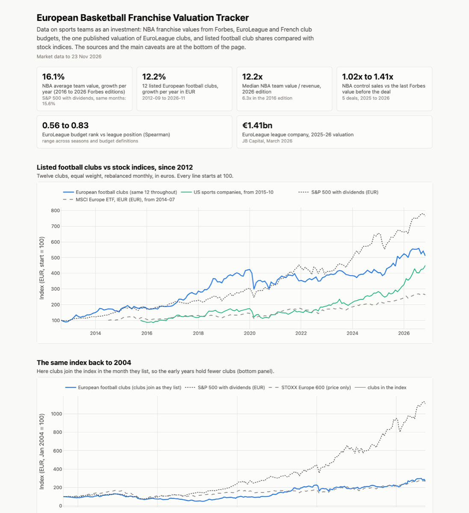

# European Basketball Franchise Valuation Tracker

Does "sports as an alternative asset class" hold up? A data pipeline and live
dashboard on European basketball franchise valuations, with the NBA and listed
football clubs as comparators. Every number is traceable to a public source.

**Stack:** Python — requests, beautifulsoup4, pandas, yfinance, plotly.
Static dashboard on GitHub Pages; monthly market-data refresh via GitHub
Actions. No databases, no frameworks.

**Dashboard:** _link goes here once GitHub Pages is enabled_



## Run

```
pip install -r requirements.txt
python run_pipeline.py                # full refresh
python run_pipeline.py --market-only  # what the monthly CI run does
python run_pipeline.py --notepack     # + /note_support chart PNGs & facts.md
                                      #   (local only; pip install -r requirements-notepack.txt)
```

## What's inside

- Equal-weight EUR index of 12 listed European football clubs vs S&P 500 TR /
  MSCI Europe — staggered-entry and fixed-composition variants, with drawdowns
  and correlations.
- NBA franchise-value CAGR, top-5 vs bottom-5 dispersion, and value/revenue
  multiples across Forbes editions, against the S&P 500 over identical windows.
- EuroLeague club budgets vs regular-season standings (Spearman, by season),
  and the JB Capital valuation of the league and its clubs.

## Data

- `data/*.csv` — clean datasets, one per source, committed.
- `data/manual/*.csv` — hand-keyed figures from sources that can't or shouldn't
  be scraped; columns documented in `data/manual/README.md`.
- `data/mappings/team_names.csv` — canonical team names used to join sources.
- `data/raw/` — cached raw HTML/XML. **Local only, gitignored** — cached page
  content is copyrighted material and is never pushed to the repo.

Source-by-source access notes: [data_inventory.md](data_inventory.md).
Every methodological choice, its rationale and the alternative:
[methodology.md](methodology.md). The dashboard carries a full
data-sources-and-caveats section.
